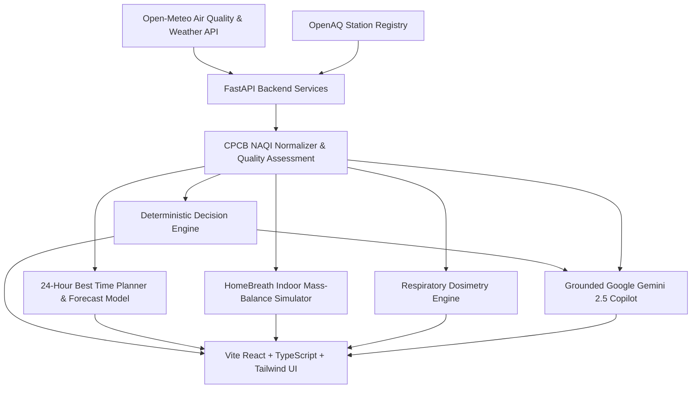

# 🍃 VayuCoach — AI-Powered Urban Air Quality Decision Intelligence
> **Tagline:** *Understand Your Air. Make Better Decisions.*  
> **Geographical Focus:** Mangaluru, Karnataka, India (Expandable to all Indian Metropolitan Areas)  
> **Regulatory Standard:** Central Pollution Control Board (CPCB) Indian National Air Quality Index (NAQI) + US-EPA AQI benchmark

---

## 🧭 Executive Overview

**VayuCoach** is a production-grade environmental intelligence and decision-support web application. Rather than passively displaying alarming AQI numbers, VayuCoach transforms real-time atmospheric telemetry into concrete everyday actions:

- **Is the air suitable for outdoor aerobic workouts or running?**
- **When is the cleanest 45-minute window to exercise outdoors?**
- **Should I open my windows for natural ventilation or keep them sealed?**
- **How does unvented deep frying (*tadka*) or mosquito coil usage spike indoor $\text{PM}_{2.5}$?**
- **How many micrograms ($\mu\text{g}$) of particulate mass will enter my lungs during a 45-minute run?**
- **How much exposure is avoided by shifting workouts to the coastal afternoon sea-breeze window?**

> [!IMPORTANT]
> **Strictly Software-Only**: VayuCoach requires **NO physical sensors, IoT devices, or hardware procurement**. All indoor pollution values are generated through first-principles mathematical mass-balance differential equations and are explicitly disclosed as simulated estimates.

---

## 🏛️ System Architecture



---

## ⚡ Technology Stack

### **Frontend**
- **Framework:** React 18+ with TypeScript & Vite
- **Styling:** Tailwind CSS with custom Deep Forest Green & Coastal Atmosphere Palette
- **Data Visualizations:** Recharts (24-hour diurnal curves, indoor emission & decay curves)
- **Icons:** Lucide React
- **Typography:** Inter (Executive interface) & JetBrains Mono (Scientific tabular telemetry)

### **Backend**
- **Framework:** Python FastAPI with Pydantic v2 validation
- **Data Science & ML:** Pandas, NumPy, Scikit-learn, XGBoost (diurnal sea-breeze boundary layer modeling)
- **HTTP Client:** HTTPX Async
- **AI Copilot:** Google Gemini API (`gemini-2.5-flash` via official `google-genai` SDK with deterministic context grounding and fallback resiliency)
- **Testing:** Pytest (11/11 automated unit and integration tests passing)

---

## 📊 Core Innovation & Decision Modules

### 1. **CPCB NAQI Normalizer & Quality Assessment**
- Implements linear piecewise interpolation for the official Central Pollution Control Board (CPCB) Indian National Air Quality Index (0–500 scale: Good, Satisfactory, Moderate, Poor, Very Poor, Severe).
- Computes US-EPA AQI alongside for comparative international clarity without conflating standards.
- Evaluates data freshness, detecting timestamp latency.

### 2. **Deterministic Environmental Decision Engine**
Calculates rule-bound decisions for:
1. **Outdoor Aerobic Exercise & Running** (evaluates lung minute ventilation at 2.5 m³/h)
2. **Walking & Light Recreation** (assesses low-exertion exposure)
3. **Cycling** (traffic queue plume avoidance)
4. **Commuting** (two-wheeler open exposure vs bus vs AC vehicle recirculation)
5. **Household Natural Ventilation** (window opening vs containment based on indoor-outdoor equilibrium)

Each decision outputs:
- Recommendation (`Recommended`, `Proceed with Caution`, `Modify Intensity/Time`, `Avoid / Postpone`)
- Primary Reason & Scientific Rationale
- Concrete Actionable Alternative
- Best Time Window
- Qualitative Confidence Level (`Higher confidence`, `Moderate confidence`, `Limited confidence`, `Insufficient data`)
- Important Limitations

### 3. **24-Hour Best Time Activity Planner**
- Models diurnal atmospheric boundary layer dynamics in coastal Karnataka.
- Morning land breeze (higher continental dust accumulation) vs afternoon Arabian Sea onshore breeze (1:00 PM – 4:00 PM, strong convective dispersion).
- Computes hourly suitability scores (0–100) and extracts the **Top 3 cleanest workout windows**.

### 4. **HomeBreath — Virtual Indoor Air Simulator**
First-principles single-compartment mass balance differential equation:
$$\frac{dC_{in}}{dt} = P \cdot \text{AER} \cdot C_{out} + \frac{S(t)}{V} - (\text{AER} + k_{dep} + k_{pur}) \cdot C_{in}$$

- **Inputs:** Room area (sq ft), cooking type (*tadka* frying: 4,200 $\mu\text{g/min}$, stir frying: 1,800 $\mu\text{g/min}$, boiling: 300 $\mu\text{g/min}$), mosquito coils (2,200 $\mu\text{g/min}$), incense sticks (1,200 $\mu\text{g/min}$), window status, exhaust fan status.
- **Outputs:** 6-hour minute-by-minute indoor $\text{PM}_{2.5}$ curve, peak concentration, time to decay back to safe baseline ($<30\ \mu\text{g/m}^3$), and counterfactual *"What-if exhaust fan had been ON"* comparison.

### 5. **Respiratory Dosimetry & Exposure Calculator**
Calculates inhaled particulate mass:
$$\text{Inhaled Mass } (\mu\text{g}) = C (\mu\text{g/m}^3) \times V_E (\text{m}^3\text{/h}) \times t (\text{h})$$
- Derived from the EPA Exposure Factors Handbook (Resting: $0.5\ \text{m}^3/\text{h}$, Walking: $1.2\ \text{m}^3/\text{h}$, Jogging: $2.5\ \text{m}^3/\text{h}$, Cardio: $3.8\ \text{m}^3/\text{h}$, with child scaling).
- Compares intake against the WHO 24-hour reference budget ($180\ \mu\text{g/day}$).
- Calculates dose avoided by shifting to the cleanest forecast window.

### 6. **Grounded Gemini AI Copilot**
- Receives deterministic calculations, current CPCB NAQI, and weather conditions.
- Strict anti-hallucination prompt boundaries (does not invent AQI values or medical diagnoses).
- Fallback intelligence engine ensures uninterrupted operation even without an API key or during network downtime.

### 7. **Data Transparency & Governance**
- Clear taxonomy table explicitly labeling information as **Measured**, **Forecasted**, **Simulated**, or **Estimated**.
- Official attribution to CPCB, Open-Meteo, OpenAQ, and WHO.

---

## 🚀 Quickstart & Installation

### 1. Prerequisites
- **Node.js**: v18+ (tested on Node v24)
- **Python**: v3.10+ (tested on Python v3.14)

---

### 2. Backend Setup

```bash
cd backend

# Create virtual environment (optional)
python -m venv venv
# On Windows:
venv\Scripts\activate
# On macOS/Linux:
source venv/bin/activate

# Install dependencies
pip install -r requirements.txt

# (Optional) Set your Gemini API key in .env or terminal
# Windows PowerShell:
$env:GEMINI_API_KEY = "your_actual_gemini_key"
# Linux/macOS:
export GEMINI_API_KEY="your_actual_gemini_key"

# Run FastAPI server
python -m uvicorn app.main:app --host 127.0.0.1 --port 8000 --reload
```
- API is live at: `http://127.0.0.1:8000`
- Interactive Swagger UI: `http://127.0.0.1:8000/docs`

---

### 3. Frontend Setup

```bash
cd frontend

# Install npm packages
npm install

# Start development server
npm run dev
```
- Open `http://localhost:5173` in your browser.

---

### 4. Running Automated Tests

```bash
cd backend
python -m pytest -v tests/test_vayucoach.py
```
*Expected result: 11 passed (covers NAQI calculation, decision thresholds, HomeBreath simulator, dosimetry, uncertainty, and API endpoints).*

---

## 🌐 Production Deployment

### **Frontend (Vercel / Netlify)**
- **Build command:** `npm run build`
- **Output directory:** `dist`
- Set `VITE_API_BASE_URL` in environment variables if backend is hosted separately.

### **Backend (Render / Railway / Fly.io)**
- **Start command:** `uvicorn app.main:app --host 0.0.0.0 --port $PORT`
- Configure `GEMINI_API_KEY` in server environment settings.
- CORS is pre-configured to support cross-origin requests.

---

## 📜 Scientific Attribution & Data Governance

1. **Central Pollution Control Board (CPCB)**: National Air Quality Index (NAQI) Breakpoint Standards.
2. **Open-Meteo**: High-resolution atmospheric chemistry and weather model (CC-BY 4.0).
3. **OpenAQ**: Global ambient air quality monitoring registry.
4. **World Health Organization (WHO)**: 2021 Global Air Quality Guidelines Reference Limits.
5. **U.S. EPA**: Exposure Factors Handbook (Respiratory Minute Volumes).
>>>>>>> bcfa1f0 (feat: complete VayuCoach urban air quality assistant with security, CPCB decision intelligence & SMTP notifications)
